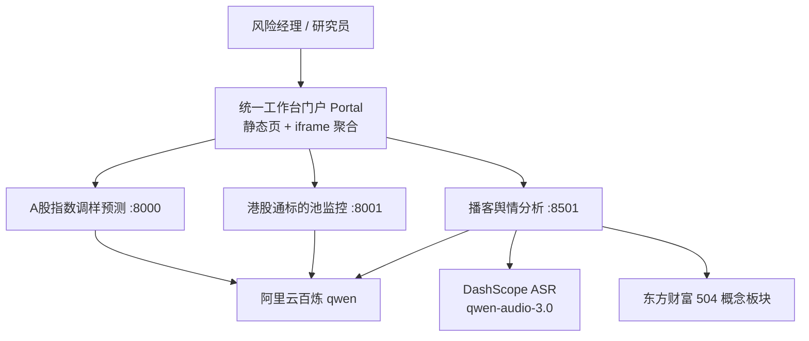

# AI 市场风险管理平台

> 实习期间独立负责三个 AI 应用系统的 0→1 架构设计与全栈开发，并构建统一工作台门户，覆盖市场风险管理的三类典型场景：**指数调样预测 · 港股通标的风险监控 · 财经播客舆情分析**。

---

## 30 秒看懂

- **三个系统**：A股指数成份股调整预测 · 港股通标的池风险监控 · 播客舆情分析（语音 → A股洞察）
- **核心 AI 能力**：Multi-Agent 编排 / LangGraph 状态图 / RAG / ASR / 量化 + LLM 增强
- **验证闭环**：用回测量化系统有效性（CSI300 综合 F1 70.7%+、港股通 Layer1 F1 79.3%）
- **产品化**：统一工作台门户，状态感知 + 一致设计系统

---

## 整体架构



整体分层：**交互层（门户 / 三系统前端）→ 编排层（Multi-Agent / LangGraph）→ 引擎层（预测 / 扫描 / 分析）→ 数据层（Tushare / akshare / 恒生 / 东财）**，三者共享同一套工程范式。

> 详细架构、AI 流水线、关键技术决策与回测指标见 **[技术白皮书 `portfolio/ARCHITECTURE.md`](./portfolio/ARCHITECTURE.md)**，架构图见 **[`portfolio/architecture_diagram.svg`](./portfolio/architecture_diagram.svg)**。

---

## 三个系统一览

| 系统 | 业务场景 | 核心 AI 能力 | 交互形态 | 默认端口 |
|---|---|---|---|---|
| **A股指数成份股调整预测** | 预判指数定期调样，辅助前瞻布局 | 量化规则 + LLM 增强双模式预测 | CLI / FastAPI / 原生 Web | 8000 |
| **港股通标的池监控** | 监控港股通标的临近调出风险 | 两层模型（HSCI 覆盖 + 港股通映射） | FastAPI / 原生 Web | 8001 |
| **播客舆情分析** | 财经播客语音 → 对 A 股的可执行洞察 | LangGraph 多智能体 + ASR + RAG + 跨市场传导 | Streamlit | 8501 |

---

## 快速开始

> **完整的安装、密钥配置与使用流程图文演示，请参阅 [`平台demo使用指导.pdf`](./平台demo使用指导.pdf)。**

### 环境准备
- Python 3.11+
- 三个独立的 conda 环境（避免依赖冲突）：`index_predictor` / `ht_proj` / `podcast_agent`
- 大模型与 ASR 密钥：阿里云百炼（qwen）与 DashScope（ASR）API Key

### 配置 API 密钥（必做）

出于安全考虑，**真实 `.env` 不会上传到 GitHub**（已被 `.gitignore` 排除）。三个系统各自目录下均提供 `.env.example` 模板，克隆后需先复制为 `.env` 并填入自己的密钥，否则系统无法调用大模型与数据接口：

| 系统 | 模板文件 | 必填项 |
|---|---|---|
| A股指数调样预测 | `index_adjustment_predictor/.env.example` | `LLM_API_KEY`（阿里云百炼）、`TUSHARE_API_TOKEN` |
| 港股通标的池监控 | `hk_connect_monitor/.env.example` | `LLM_API_KEY`（阿里云百炼）、`TUSHARE_API_TOKEN` |
| 播客舆情分析 | `podcast_public_opinion_analysis/podcast_agent/.env.example` | `DASHSCOPE_API_KEY`（统一回落 Key）、`LISTENNOTES_API_KEY`（播客采集） |

```bash
# 示例：将模板复制为 .env 后，编辑填入真实密钥
cp index_adjustment_predictor/.env.example index_adjustment_predictor/.env
cp hk_connect_monitor/.env.example hk_connect_monitor/.env
cp podcast_public_opinion_analysis/podcast_agent/.env.example podcast_public_opinion_analysis/podcast_agent/.env
```

> 各 Key 的获取入口见 `.env.example` 内注释（阿里云百炼 / Tushare / Listen Notes）；播客系统的 Embedding、Rerank、ASR 等其余配置项可选，缺省时自动回落到 `DASHSCOPE_API_KEY`。

### 启动三个后端

```bash
# ① A股指数调样预测
conda activate index_predictor
cd index_adjustment_predictor
python main.py --api            # → http://localhost:8000

# ② 港股通标的池监控
conda activate ht_proj
cd hk_connect_monitor
python main_chat.py --api --port 8001   # → http://localhost:8001

# ③ 播客舆情分析
conda activate podcast_agent
cd podcast_public_opinion_analysis/podcast_agent
pip install -e ".[all]"
python -m streamlit run src/podcast_agent/web/app.py --server.port 8501  # → http://localhost:8501
```

### 打开统一门户
直接用浏览器打开 `portal/index.html` 即可（也可起任意静态服务器）。门户会自动探活三个系统并显示运行状态。

> 项目根目录提供 `portal/start_all.bat`（Windows）一键拉起三套服务并打开门户，需按本机 conda 路径调整 `PY_*` 变量。

---

## 技术栈

Python · FastAPI · Streamlit · LangGraph · Multi-Agent 编排 · RAG（ChromaDB + BM25 + Rerank）· ASR（DashScope）· LLM（阿里云百炼 qwen）· 原生 HTML/CSS/JS 前端

| 层 | CSI300 | 港股通 | 播客 |
|---|---|---|---|
| 编排 | 自研 orchestrator + skill.md | 自研 orchestrator_b | LangGraph StateGraph |
| 接口 | CLI / FastAPI / 原生 HTML | FastAPI / 原生 HTML | Streamlit / Typer |
| LLM | 阿里云百炼 qwen | 阿里云百炼 qwen3.7-plus | 阿里云百炼 qwen |
| ASR | — | — | DashScope qwen-audio-3.0-asr |
| 检索 | — | — | ChromaDB + BM25 + qwen3-rerank |
| 数据 | Tushare / AKShare / SQLite | akshare / 上交所 / 恒生 / JSON | SQLite / 东财概念板块 |

---

## 验证指标（回测）

| 系统 | 期次 | 指标 | 数值 |
|---|---|---|---|
| CSI300 | 2025-06 | 综合 F1 | 71.43% |
| CSI300 | 2026-06 | 综合 F1 | 70.73%（调出召回 92.68%，19/19） |
| 港股通 | 2026-03 | Layer1 F1 | 79.3% |
| 港股通 | 2026-03 | Layer2 F1 | 70.9% |

---

## 目录结构

```
market-risk-ai-platform/
├── index_adjustment_predictor/   # 系统一：A股指数调样预测
├── hk_connect_monitor/           # 系统二：港股通标的池监控
├── podcast_public_opinion_analysis/  # 系统三：播客舆情分析
│   └── podcast_agent/            #   实际 Python 包与启动目录
├── portal/                       # 统一工作台门户（静态前端 + 启动脚本）
└── portfolio/                    # 技术白皮书与架构图（深度文档）
```

---

## 文档导航

| 文档 | 内容 |
|---|---|
| [平台demo使用指导.pdf](./平台demo使用指导.pdf) | **使用演示（推荐先看）**：安装、密钥配置与三系统操作的完整图文演示 |
| [portfolio/ARCHITECTURE.md](./portfolio/ARCHITECTURE.md) | 技术架构白皮书：三系统真实架构、AI 流水线、关键决策与回测指标 |
| [portfolio/architecture_diagram.svg](./portfolio/architecture_diagram.svg) | 整体架构图 |
| [index_adjustment_predictor/README.md](./index_adjustment_predictor/README.md) | 系统一详细说明 |
| [hk_connect_monitor/README.md](./hk_connect_monitor/README.md) | 系统二详细说明 |
| [podcast_public_opinion_analysis/README.md](./podcast_public_opinion_analysis/README.md) | 系统三详细说明 |
| [portal/README.md](./portal/README.md) | 统一门户使用说明 |

---

## 说明

- 本项目为**个人实习作品集**，相关内部数据已做脱敏与泛化处理。
- 当前仓库保留原始实习单位品牌标识，仅用于内部演示与评审；对外公开发布前，建议去除品牌标识并改用公开数据口径（如 Tushare 公开接口）。
- 当前部署形态为**本地单机工具**，如需"给网址即用"，可迁移为自托管 Web 应用（反向代理同源 + 简单鉴权），详见白皮书第 7 节。
